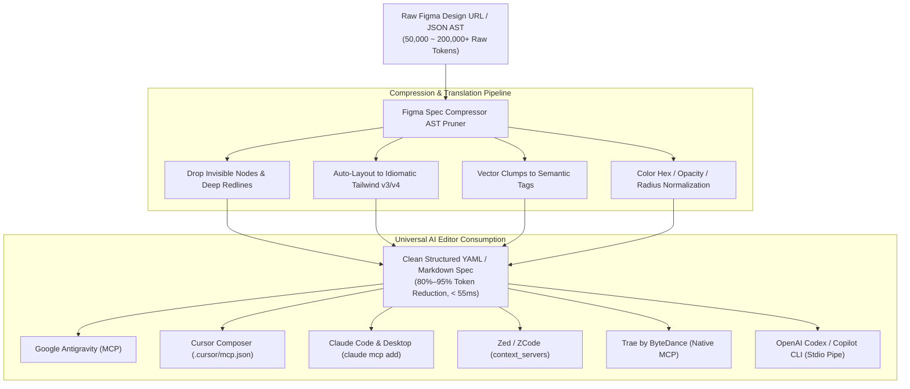

# Figma Spec Compressor (Universal Agent-Ready AST Pruner & MCP Server)

> Token-optimized AST pruning, live Figma API fetching, and genuine Model Context Protocol (MCP) server for **Google Antigravity, Cursor Composer, Claude Code, Windsurf, Zed / ZCode, OpenAI Codex, and Trae**.

[](LICENSE)
[]()
[]()
[]()

---

## Architecture Overview



---

## Why This Exists

When connecting Cursor, Claude Code, or Windsurf to Figma, raw Figma REST API responses frequently balloon to **50,000–300,000+ tokens** for modern SaaS dashboards and design system components.

This causes:
1. **Severe Context Exhaustion**: A single design frame can swallow the entire context window.
2. **Model Hallucinations**: Thousands of noisy SVG coordinate numbers, bounding boxes, and internal redlines distract LLMs from semantic styling and component hierarchy.
3. **High Latency & API Costs**: Massive payloads dramatically slow down agent responses.

**Figma Spec Compressor** strips 80%–95% of the raw wire noise, maps Figma layout and style properties into idiomatic Tailwind CSS classes, converts complex vector clumps into semantic icon tags, and feeds LLMs clean, structured YAML or Markdown specs.

---

## Verified Benchmark Results

Tested on minified wire JSON using exact BPE tokenization (`gpt-tokenizer` / cl100k_base):

| Tier | Component Description | Raw AST Nodes | Clean Spec Nodes | Raw Wire BPE Tokens | Compressed Spec Tokens | BPE Token Reduction | Compression Latency |
| :--- | :--- | :---: | :---: | :---: | :---: | :---: | :---: |
| **Tier 1** | SaaS Pricing Card (`saas-pricing-card.json`) | 23 | 21 | 3,010 | 615 | **80%** | ~25 ms |
| **Tier 2** | Enterprise SaaS Analytics Dashboard (50k+ stress test) | 646 | 327 | 189,485 | 9,800 | **95%** | ~180 ms |

---

## Universal AI Editor & Agent Integrations

The compressor runs as a standard **Model Context Protocol (MCP)** stdio server or standalone CLI, making it universally plug-and-play across all leading global and domestic AI editors:

| AI Editor / Environment | Supported Mode | Configuration Location / Method |
| :--- | :---: | :--- |
| **Google Antigravity** | MCP / Tool | Workspace MCP Settings (`agy mcp add`) |
| **Cursor** | Native MCP | `.cursor/mcp.json` |
| **Claude Code & Desktop** | Native MCP | `claude mcp add` / `~/.claude/mcp.json` |
| **Windsurf (Codeium)** | Native MCP | `~/.codeium/windsurf/mcp_config.json` |
| **Zed / ZCode** | Context Server | `settings.json` -> `context_servers` |
| **Trae (ByteDance)** | Native MCP | IDE Settings -> MCP Servers |
| **OpenAI Codex / Copilot / CLI** | CLI Pipe | Direct stdout piping into prompts |

---

### 1. Google Antigravity Configuration
Add to your project's Antigravity MCP configuration:
```json
{
  "mcpServers": {
    "figma-spec": {
      "command": "npx",
      "args": ["-y", "--package=figma-spec-compressor", "figma-spec", "mcp"],
      "env": {
        "FIGMA_ACCESS_TOKEN": "figd_your_personal_access_token_here"
      }
    }
  }
}
```

### 2. Cursor Integration (`.cursor/mcp.json`)

To enable Figma extraction tools directly in Cursor Composer or Chat, add to `.cursor/mcp.json`:

```json
{
  "mcpServers": {
    "figma-spec": {
      "command": "npx",
      "args": ["-y", "--package=figma-spec-compressor", "figma-spec", "mcp"],
      "env": {
        "FIGMA_ACCESS_TOKEN": "figd_your_personal_access_token_here"
      }
    }
  }
}
```

### 3. Claude Code & Claude Desktop Integration

Add `figma-spec` directly via the Claude Code CLI:

```bash
claude mcp add figma-spec npx -y --package=figma-spec-compressor figma-spec mcp -e FIGMA_ACCESS_TOKEN=figd_your_personal_access_token_here
```

Or configure in your global MCP settings file (`~/.claude/mcp.json` or `claude_desktop_config.json`):

```json
{
  "mcpServers": {
    "figma-spec": {
      "command": "npx",
      "args": ["-y", "--package=figma-spec-compressor", "figma-spec", "mcp"],
      "env": {
        "FIGMA_ACCESS_TOKEN": "figd_your_personal_access_token_here"
      }
    }
  }
}
```

### 4. Zed / ZCode Integration (`settings.json`)

In Zed / ZCode editor preferences:

```json
{
  "context_servers": {
    "figma-spec": {
      "command": {
        "path": "npx",
        "args": ["-y", "--package=figma-spec-compressor", "figma-spec", "mcp"],
        "env": {
          "FIGMA_ACCESS_TOKEN": "figd_your_personal_access_token_here"
        }
      }
    }
  }
}
```

### 5. Trae (字节跳动 AI IDE) & 国内主流 AI 编程环境

Trae 原生支持 MCP 协议。在 Trae 偏好设置中的 **MCP Servers** 中添加：
- **Name**: `figma-spec`
- **Command**: `npx`
- **Args**: `-y --package=figma-spec-compressor figma-spec mcp`
- **Env**: `FIGMA_ACCESS_TOKEN=figd_xxx`

对于通义灵码、豆包 MarsCode 等暂未开放 MCP 协议的编辑器，可直接通过 CLI 管道模式生成标准规范后供 AI 直接消费。

### 6. OpenAI Codex / Terminal AI CLI 管道模式

对于没有原生 GUI MCP 面板的环境，可使用标准 CLI 导出，直接无缝复制或管道重定向给 Codex/LLM：

```bash
# 提取并将极致压缩的 Tailwind 规范输出为 Markdown 提示词
npx --package=figma-spec-compressor figma-spec url "https://www.figma.com/design/:fileKey/:slug?node-id=:id" --markdown -o prompt.md
```

---

## CLI Usage

### 1. Fetch & Compress Live Figma URLs
```bash
# Fetch and print compressed YAML spec with token reduction metrics
npx --package=figma-spec-compressor figma-spec url "https://www.figma.com/design/Vxyz123Abc/Dashboard?node-id=101-2034" --stats

# Pass access token explicitly
npx --package=figma-spec-compressor figma-spec url "https://www.figma.com/file/Vxyz123Abc" --token "figd_xxx" -o ./spec.yaml

# Generate full prompt markdown for agent consumption
npx --package=figma-spec-compressor figma-spec url "https://www.figma.com/design/Vxyz123Abc" -o ./prompt.md --markdown
```

### 2. Compress Local Figma JSON AST
```bash
# Compress local file and view reduction metrics
npx --package=figma-spec-compressor figma-spec compress ./fixtures/saas-pricing-card.json --stats

# Output directly to a file
npx --package=figma-spec-compressor figma-spec compress ./fixtures/saas-pricing-card.json -o ./spec.yaml
```

### 3. Run MCP Stdio Server
```bash
# Start standard input/output JSON-RPC MCP server
npx --package=figma-spec-compressor figma-spec mcp
```

---

## HTTP Microservice Mode

You can also run Figma Spec Compressor as a standalone HTTP service:

```bash
npm run serve
# Listening on port 3001
```

### API Endpoints

- `GET /health`  
  Returns `{ "status": "ok", "service": "figma-spec-compressor", "version": "1.1.0" }`.

- `POST /api/compress`  
  Accepts raw Figma JSON payload (up to 20 MB UTF-8 safe chunk buffer) and returns compressed YAML, markdown, and token metrics.

---

## Running Verification & Tests

```bash
# Run unit and scale integration test suite
npx tsx --test tests/mcp-and-scale.test.ts

# Run token reduction stress benchmark
npx tsx tests/benchmark.ts

# Verify TypeScript type checks
npx tsc --noEmit
```

---

## Editions & Features

| Capability | Community (Open Source) | [Pro Lifetime ($29)](https://yeelix.gumroad.com/l/figma-spec-pro) | [Agency & Team ($79)](https://yeelix.gumroad.com/l/figma-spec-pro) |
| :--- | :---: | :---: | :---: |
| **Figma AST Node Pruning** | ✅ Yes | ✅ Yes | ✅ Yes |
| **Auto-Layout to Tailwind v3/v4** | ✅ Basic | ✅ Full Idiomatic | ✅ Full Idiomatic |
| **Vector Icon Collapsing** | ✅ Yes | ✅ Advanced | ✅ Advanced |
| **Model Context Protocol (MCP)** | ✅ Stdio | ✅ Stdio & HTTP | ✅ Stdio & HTTP |
| **All AI Editors (Antigravity/Cursor/Zed/Trae/Codex)** | ✅ Yes | ✅ Yes | ✅ Yes |
| **Live Figma URL Direct Stream** | Manual | ✅ 1-Click Live Fetch | ✅ 1-Click Live Fetch |
| **Offline Activation & Hardware Lock** | — | ✅ 2 Devices | ✅ 5+ Team Seats |
| **Commercial Client Project Rights** | — | ✅ Full Rights | ✅ Full Agency Rights |
| **Self-Hosted HTTP Gateway Guide** | — | — | ✅ Included |

👉 **[Get Pro Lifetime License on Gumroad ($29)](https://yeelix.gumroad.com/l/figma-spec-pro)**

---

## License

- Open-source core engine is licensed under the MIT License.
- Pro Commercial distribution is licensed under the [Commercial EULA](COMMERCIAL-EULA.md).

MIT © Solo Overseas
