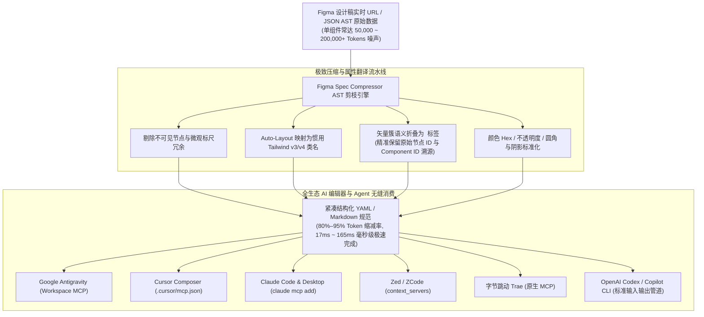

[English](./README.md) | [简体中文](./README.zh-CN.md)

# Figma Spec Compressor（通用 AI 编程 Agent 原生 Figma AST 剪枝引擎与 MCP 服务器）

> 专为 **Google Antigravity、Cursor Composer、Claude Code、Windsurf、Zed / ZCode、OpenAI Codex 与 字节跳动 Trae** 打造的高性能 Token 优化 AST 剪枝引擎、Figma 实时 API 解析工具与标准模型上下文协议（MCP）服务。

[](LICENSE)
[]()
[]()
[]()

> [!IMPORTANT]
> **授权声明**：本开源版仅允许个人学习与非商业使用，公司、团队或任何商业用途必须购买商用版授权，未经授权的商业使用构成侵权。

---

## 架构概览 (Architecture Overview)



---

## 痛点与核心价值

当使用 Cursor、Claude Code 或 Windsurf 连接 Figma 时，原生的 Figma REST API 返回的数据通常非常庞大，现代 SaaS 仪表盘或复杂组件动辄达到 **50,000–300,000+ Tokens**。

这会导致极具破坏性的开发问题：
1. **上下文窗口瞬间耗尽**：仅单个设计画框就会塞满整个上下文窗口，后续对话立即断截。
2. **LLM 产生几何幻觉**：数以万计的复杂 SVG 坐标数字、网格切片、内部设计标尺严重干扰大模型对语义层级和样式的理解。
3. **高昂的 API 账单与响应迟钝**：超大体量 Payload 显著拖慢 Agent 回复速度并使推理成本暴涨。

**Figma Spec Compressor** 剔除了 80%–95% 的线上传输噪声，将 Figma 布局与样式属性转化为地道的 Tailwind CSS 类名，将成百上千的复杂矢量碎片语义折叠为极简图标规范（并保留源节点溯源 ID），为 LLM 提供精简、清晰、高保真的结构化 YAML 或 Markdown 规范。

---

## 实测基准数据 (Verified Benchmark Results)

在纯净线上 Minified JSON 下使用真实 BPE 算法（`gpt-tokenizer` / cl100k_base 编码器）实测得出：

| 测试层级 | 组件说明 | 原始 AST 节点数 | 净化后 Spec 节点数 | 原始传输 BPE Tokens | 压缩后 Spec Tokens | BPE Token 缩减率 | 压缩计算延迟 |
| :--- | :--- | :---: | :---: | :---: | :---: | :---: | :---: |
| **Tier 1** | SaaS 定价卡片 (`saas-pricing-card.json`) | 23 | 21 | 3,010 | 642 | **79%** | 21.02 ms |
| **Tier 2** | 企业级 SaaS 分析仪表盘 (50k+ 压力测试) | 646 | 327 | 189,485 | 10,384 | **95%** | 165.19 ms (~165 ms) |

> **基准测试方法说明**：Tier 1 基于真实脱敏的 SaaS 定价卡片组件（`fixtures/saas-pricing-card.json`）测试；Tier 2 基于程序化生成的 646 节点合成企业级仪表盘压力测试用例，专门用于在极端噪声场景下严格验证 AST 剪枝与矢量簇折叠算法的鲁棒性。

---

## 全球与国内主流 AI 编辑器集成指南

本工具内置标准的 **模型上下文协议 (Model Context Protocol, MCP)** stdio 服务与独立 CLI，支持在各类海外与国内主流 AI 编程环境中即插即用：

| AI 编辑器 / 开发环境 | 支持模式 | 配置文件路径 / 接入方法 |
| :--- | :---: | :--- |
| **Google Antigravity** | MCP / Tool | 工作区 MCP 设置 (`agy mcp add`) |
| **Cursor** | 原生 MCP | `.cursor/mcp.json` |
| **Claude Code & Desktop** | 原生 MCP | `claude mcp add` / `~/.claude/mcp.json` |
| **Windsurf (Codeium)** | 原生 MCP | `~/.codeium/windsurf/mcp_config.json` |
| **Zed / ZCode** | Context Server | `settings.json` -> `context_servers` |
| **Trae (字节跳动)** | 原生 MCP | IDE 设置 -> MCP Servers |
| **OpenAI Codex / 命令行 CLI** | 管道输出 | 终端 stdout 直接管道重定向注入 Prompt |

---

### 1. Google Antigravity 配置
在项目的 Antigravity MCP 配置中添加：
```json
{
  "mcpServers": {
    "figma-spec": {
      "command": "npx",
      "args": ["-y", "github:leethoneid/figma-spec-compressor", "mcp"],
      "env": {
        "FIGMA_ACCESS_TOKEN": "figd_your_personal_access_token_here"
      }
    }
  }
}
```

### 2. Cursor 集成 (`.cursor/mcp.json`)

在项目根目录创建或编辑 `.cursor/mcp.json`：

```json
{
  "mcpServers": {
    "figma-spec": {
      "command": "npx",
      "args": ["-y", "github:leethoneid/figma-spec-compressor", "mcp"],
      "env": {
        "FIGMA_ACCESS_TOKEN": "figd_your_personal_access_token_here"
      }
    }
  }
}
```

### 3. Claude Code 与 Claude Desktop 集成

直接通过 Claude Code 官方命令行添加：

```bash
claude mcp add figma-spec npx -y github:leethoneid/figma-spec-compressor mcp -e FIGMA_ACCESS_TOKEN=figd_your_personal_access_token_here
```

或在全局 MCP 配置文件（`~/.claude/mcp.json` 或 `claude_desktop_config.json`）中配置：

```json
{
  "mcpServers": {
    "figma-spec": {
      "command": "npx",
      "args": ["-y", "github:leethoneid/figma-spec-compressor", "mcp"],
      "env": {
        "FIGMA_ACCESS_TOKEN": "figd_your_personal_access_token_here"
      }
    }
  }
}
```

### 4. Zed / ZCode 集成 (`settings.json`)

在 Zed 首选项配置中添加：

```json
{
  "context_servers": {
    "figma-spec": {
      "command": {
        "path": "npx",
        "args": ["-y", "--package=figma-spec-compressor", "figma-spec", "mcp"],
        "env": {
          "FIGMA_ACCESS_TOKEN": "figd_your_personal_access_token_here"
        }
      }
    }
  }
}
```

### 5. Trae (字节跳动 AI IDE) 与国内 AI 编程环境

Trae 原生深度支持 MCP 协议。在 Trae 偏好设置中的 **MCP Servers** 中添加：
- **Name**: `figma-spec`
- **Command**: `npx`
- **Args**: `-y github:leethoneid/figma-spec-compressor mcp`
- **Env**: `FIGMA_ACCESS_TOKEN=figd_xxx`

对于通义灵码、豆包 MarsCode 等暂未开放 MCP 协议的编辑器，可直接通过 CLI 管道模式生成标准规范后供 AI 直接消费。

### 6. OpenAI Codex / 终端 CLI 管道模式

对于没有原生 GUI MCP 面板的环境，可使用标准 CLI 导出，直接无缝复制或管道重定向给 Codex/LLM：

```bash
# 提取并将极致压缩的 Tailwind 规范输出为 Markdown 提示词
npx -y github:leethoneid/figma-spec-compressor url "https://www.figma.com/design/:fileKey/:slug?node-id=:id" --markdown -o prompt.md
```

---

## 命令行 CLI 使用指南

### 1. 实时抓取并压缩线上 Figma URL
```bash
# 抓取并打印紧凑 YAML 规范及 Token 优化指标
npx -y github:leethoneid/figma-spec-compressor url "https://www.figma.com/design/Vxyz123Abc/Dashboard?node-id=101-2034" --stats

# 显式传入个人 Access Token 并保存到本地
npx -y github:leethoneid/figma-spec-compressor url "https://www.figma.com/file/Vxyz123Abc" --token "figd_xxx" -o ./spec.yaml

# 生成供 AI Agent 直接消费的完整 Markdown 提示词文件
npx -y github:leethoneid/figma-spec-compressor url "https://www.figma.com/design/Vxyz123Abc" -o ./prompt.md --markdown
```

### 2. 压缩本地离线 Figma JSON AST
```bash
# 压缩本地 JSON 文件并查看 Token 缩减指标
npx -y github:leethoneid/figma-spec-compressor compress ./fixtures/saas-pricing-card.json --stats

# 直接将压缩规范输出至文件
npx -y github:leethoneid/figma-spec-compressor compress ./fixtures/saas-pricing-card.json -o ./spec.yaml
```

### 3. 运行标准 Stdio MCP 服务
```bash
# 启动标准输入输出 JSON-RPC MCP 协议微服务
npx -y github:leethoneid/figma-spec-compressor mcp
```

---

## 自托管 HTTP 微服务模式

Figma Spec Compressor 也支持作为独立 HTTP 微服务运行：

```bash
npm run serve
# 服务默认在 127.0.0.1:3001 端口启动
```

### API 接口列表

- `GET /health`  
  返回健康检查数据 `{ "status": "ok", "service": "figma-spec-compressor", "version": "1.1.0" }`。

- `POST /api/compress`  
  接收 Figma 原始 JSON AST（支持最高 20 MB 强校验安全分块缓冲），返回压缩后结构化 YAML、Markdown 及 Token 缩减指标。

---

## 本地验证与测试套件

```bash
# 运行全部单元测试与大规模集成压力测试
npm test

# 运行大规模 Token 缩减基准测试
npm run benchmark

# 执行 TypeScript 类型严格检查
npx tsc --noEmit
```

---

## 版本对比与商业授权权益

| 功能特性 | Community 社区开源版 | [Pro 终身买断个人版 ($29)](https://yeelix.gumroad.com/l/figma-spec-pro) | [Agency & 团队商业版 ($79)](https://yeelix.gumroad.com/l/figma-spec-pro) |
| :--- | :---: | :---: | :---: |
| **Figma AST 核心剪枝引擎** | ✅ 包含 | ✅ 包含 | ✅ 包含 |
| **Auto-Layout 转 Tailwind v3/v4** | ✅ 基础支持 | ✅ 完整惯用语法映射 | ✅ 完整惯用语法映射 |
| **矢量图标簇智能折叠与 ID 溯源** | ✅ 包含 | ✅ 高级折叠 | ✅ 高级折叠 |
| **标准模型上下文协议 (MCP)** | ✅ Stdio 模式 | ✅ Stdio 与 HTTP 双模式 | ✅ Stdio 与 HTTP 双模式 |
| **全生态 AI 编辑器支持** | ✅ 包含 | ✅ 包含 | ✅ 包含 |
| **实时 Figma URL 一键秒级直连抓取** | 手动导包 | ✅ 一键直抓解析 | ✅ 一键直抓解析 |
| **离线激活与本地硬件锁绑定** | — | ✅ 终身 2 台设备授权 | ✅ 5+ 团队席位授权 |
| **商业客户交付与商用项目权** | — | ✅ 完整商用授权 | ✅ 完整 Agency 企业级授权 |
| **自托管 HTTP 微服务网关指南** | — | — | ✅ 包含专属部署指南 |

👉 **[在 Gumroad 获取 Pro 终身商业授权 ($29)](https://yeelix.gumroad.com/l/figma-spec-pro)**

---

## 开源协议与商用授权

- 核心开源引擎遵循 [PolyForm Noncommercial License 1.0.0](LICENSE) 非商业许可协议。
- 商业加固发行版遵循 [Commercial EULA](COMMERCIAL-EULA.md) 商业授权协议。

Copyright (c) 2026 Solo Overseas. All rights reserved.
